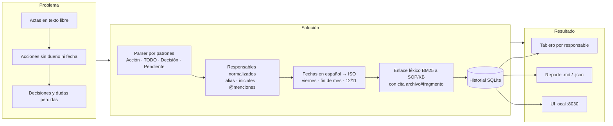

<div align="center">

# meeting-actions-local

**De actas de reunión a acciones con responsable, fecha y respaldo en SOP** · Angel Salazar

`Python 3.10+` · `FastAPI` · `SQLite` · `BM25 léxico` · sin LLM en la nube

</div>

---

### `$ cat diagrama.md`



### `$ cat problema.md`

Después de cada reunión alguien tiene que releer las notas para saber quién hace qué y para cuándo. Las acciones quedan enterradas entre párrafos, las decisiones se olvidan y nadie recuerda qué SOP aplica a cada compromiso. Este proyecto lee actas en español (markdown o texto plano), extrae acciones con responsable, fecha, estado y confianza, separa decisiones y preguntas abiertas, y las vincula con fragmentos de SOP cuando hay evidencia léxica. Todo corre en tu máquina, con reglas y BM25.

---

### `$ cat estructura.md`

```
meeting-actions-local/
  samples/meetings/   5 actas de ejemplo (.md y .txt)
  samples/kb/         7 SOP en texto para enlazar
  src/meeting_actions/
    parse.py     patrones: acciones, decisiones, preguntas, campos, estados
    dates.py     fechas en español → ISO, relativas a la fecha de la reunión
    owners.py    asistentes, alias, iniciales, menciones
    linker.py    BM25 sobre fragmentos del KB, con citas
    report.py    meeting_report.md / .json
    store.py     historial y auditoría en SQLite
    pipeline.py  orquesta parse → owners → KB → store
    cli.py       parse · batch · report · serve · history
    web.py       FastAPI + UI Bootstrap
  tests/test_pipeline.py
  results/       history.db, meeting_report.{md,json}
```

---

### `$ cat formatos.md`

El parser reconoce estas formas, mezcladas en la misma acta:

| Tipo | Ejemplos |
|---|---|
| Acción | `Acción: ...`, `TODO: ...`, `TODO(carlos): ...`, `Pendiente: ...`, `- [ ] ...`, `- [x] ...` |
| Compromiso natural | `Ana se encargará de ...`, `Luis deberá ...`, `Pamela preparará ...`, `@hugo coordinar ...`, `Hugo: validar ...`, `Hay que ...` |
| Campos | `responsable:`, `resp:`, `fecha:`, `plazo:`, `estado:`, `prioridad:` en la misma línea (`\|`, `;`, `(...)`) o en líneas siguientes |
| Decisión | `Decisión: ...`, `Acuerdo: ...`, `Se acordó que ...`, `Se decidió ...`, sección `## Decisiones` |
| Pregunta abierta | `Pregunta: ...`, `Duda: ...`, `Por definir: ...`, `Pendiente de definir: ...`, `¿...?`, sección `## Preguntas abiertas` |
| Estado | `(hecho)`, `(en curso)`, `estado: bloqueada`, casillas `[x]` |
| Fechas | `2026-11-20`, `20/11/2026`, `20/11`, `20 de noviembre`, `mañana`, `viernes`, `próximo lunes`, `fin de mes`, `en 2 semanas`, `en 3 días hábiles` |

Las fechas relativas se calculan desde `Fecha:` del acta (o la fecha en el nombre del archivo). La confianza sube con marcador explícito, responsable y fecha, y baja en frases sin dueño (`Hay que ...`).

Los alias salen de `Asistentes:` (`Carlos Ruiz (CR)`, `Mariano Quispe (Mari)`). Para apodos que el acta no declara se puede pasar un JSON `{"cr": "Carlos Ruiz"}` con `--aliases`.

---

### `$ bash`

```bash
cd meeting-actions-local
python -m venv .venv
.venv\Scripts\activate            # Linux/macOS: source .venv/bin/activate
pip install -e .

meeting-actions parse samples/meetings/2026-11-02_planificacion-sprint.md
meeting-actions parse samples/meetings/2026-11-09_revision-seguridad.md --json
meeting-actions batch samples/meetings --report
meeting-actions report --as-of 2026-11-17
meeting-actions history
meeting-actions history --owners
meeting-actions history --audit
meeting-actions serve                  # http://127.0.0.1:8030

pytest
```

`python -m meeting_actions ...` es equivalente al comando `meeting-actions`.

Opciones comunes: `--kb-dir`, `--no-kb`, `--results-dir`, `--db`, `--aliases`, `--as-of YYYY-MM-DD` (o las variables `MEETING_KB_DIR`, `MEETING_RESULTS_DIR`, `MEETING_DB`, `MEETING_ALIASES`).

Salidas en `results/`: `meeting_report.md`, `meeting_report.json` e `history.db` (tablas `runs`, `action_rows`, `audit`).

### `$ ls ui`

UI en **http://127.0.0.1:8030**: pega o sube un acta (`.md`/`.txt`), o carga una de ejemplo, y obtén el tablero de acciones por responsable con fecha, estado, confianza y citas al KB, más decisiones y preguntas abiertas. Permite descargar el reporte en `.md` o `.json` y guarda cada corrida en el historial.

Endpoints: `POST /api/analyze`, `GET /api/samples`, `POST /api/samples/{nombre}`, `GET /api/history`, `GET /api/runs/{id}`, `GET /api/audit`, `GET /api/health`.

---

<div align="center">

Hecho en Lima · Angel Salazar · CIP 404730

</div>
